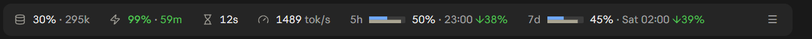

# 📊 session-hud

[](https://github.com/eminakcil/session-hud/actions/workflows/ci.yml)

**Your CLI status line, in the Claude Code desktop app.**

session-hud is a Claude Code mod that draws a row above the prompt with the figures a terminal status line gives you: context fill, prompt cache hit and time left, response speed, the 5-hour and weekly limits with their pace, and git. A side pane holds the rest. It only draws: it sends no model requests and writes no files.

**[Install](#-install)** · [What it shows](#-what-it-shows) · [Options](#%EF%B8%8F-options) · [What it can reach](#-what-it-can-reach) · [Limits](#-limits) · [Develop](#%EF%B8%8F-develop)



Captured in the desktop app's Code tab on Claude Code 2.1.322, dark theme.

## 🚀 Install

Needs Claude Code 2.1.322 or later.

```sh
claude plugin marketplace add eminakcil/claude-code-mods
claude plugin install session-hud@emin-akcil-claude-mods
```

Restart Claude Code or run `/reload-plugins` in an open session.

**Desktop app**: **+** next to the prompt box → **Plugins** → **Add marketplace** `eminakcil/claude-code-mods` → **Add plugin** → session-hud.

## ✨ What it shows

### Band above the prompt

| | Figure | Details |
| --- | --- | --- |
| 🌿 | **Git** | Branch, linked worktree, upstream with commits not pushed `↑` and not pulled `↓`, staged / modified / untracked / conflicted counts. Inside a repository only. |
| 🧠 | **Context** | Share of the window used, and tokens |
| ⚡ | **Prompt cache** | Hit rate of the last turn and minutes until the cache expires (seconds in the last minute); `cold` once expired |
| ⏳ | **Time to first token** | Of the last main-loop request |
| 🏎️ | **Output speed** | Tokens per second of the last main-loop request |
| 📅 | **Usage limits** | 5-hour and weekly: a two-row bar (quota used on top, window gone underneath), the reset time and the pace. `↓38%` means use runs 38 points behind the clock. |
| ☰ | **Menu** | Opens or closes the side pane |

💡 Hover an icon or a limit bar for its details in a tooltip: the context breakdown, cache read and write tokens, session averages, time to reset.

### Side pane

Open it with ☰ or `/hud`.

- 🆔 **Session:** the session id, with a Copy button
- 🌿 **Git:** branch, worktree, upstream, commits not pushed and not pulled, changes
- 🧠 **Context:** fill bar, tokens until auto-compact, breakdown by category
- 🔢 **Tokens:** input, output, cache read, cache write and total, for the last turn, the session and its subagents
- ⚡ **Prompt cache:** hit rate, time left, session average
- 🏎️ **Response speed:** last and average time to first token and output speed, turn length
- 📅 **Usage limits:** reset times and pace, session cost

Cache and speed figures count the main conversation only. Subagent tokens get their own column in the token table.

## ⚙️ Options

In `/config`, under session-hud:

    Cache TTL:  1h | 5m

The prompt cache lifetime the countdown runs against. `1h` (the default) matches included subscription usage. API-key and cloud-provider sessions default to five minutes unless `promptCacheTtl` says otherwise.

## 🔍 What it can reach

Validated on Claude Code 2.1.322:

    ❯ ./register.tsx hooks: session.start, command.run{command=hud}, session.measure, tool.call, turn.step, turn.complete, ui.render{component=AbovePrompt}, ui.render{component=Pane, requestId=session-hud}
    ❯ ./register.tsx calls: $.clock.every (via tick), $.clock.now, $.command.register, $.process.run (via readGit), $.session.id, $.session.usage (via refreshUsage), $.state.get, $.state.set, $.ui.close, $.ui.copy, $.ui.open (via togglePane), $.ui.panes (via togglePane), $.ui.resolve, $.ui.toast

- `turn.step` reads each response's token counts and timing. It never changes a request or reads prompt text.
- `tool.call` only notes that a Bash, PowerShell, Edit or Write call finished, to read git again. It passes every call on untouched.
- `$.process.run` runs two read-only git commands in the session's folder: `git status --porcelain=v2 --branch` and `git rev-parse`. It never fetches, commits or writes.
- `$.ui.copy` runs only when you press Copy in the pane.

## 🚧 Limits

- 🌗 Follows the `theme` setting: a light theme (`light`, `light-daltonized`, `light-ansi`) draws icons and bars in a darker palette; `auto` and dark themes use the dark one.
- ⏱️ The cache countdown shows whole minutes until the last one. Redrawing the band every second reset the pointer's hover on it.
- 🔄 "Not pulled" counts against the last `git fetch`. The mod never fetches.
- 🧮 The countdown is an estimate from the last request's time and the TTL option. It does not check the server's cache.
- 🖥️ Built for the desktop app. The terminal draws text stand-ins for the icons and bars.

## 🛠️ Develop

See [CONTRIBUTING.md](CONTRIBUTING.md). From the repository root:

```sh
claude plugin validate .
claude plugin test .
```

| File | Role |
| --- | --- |
| `hooks/register.tsx` | Hooks: data collection, the band and the pane |
| `hooks/calc.ts` | Formatting, cache tones, limit pace |
| `hooks/git.ts` | Reads `git status --porcelain=v2 --branch` and worktree info |
| `hooks/icons.ts` | [Lucide](https://lucide.dev) icon paths (ISC license), bars, dark and light palettes |
| `tests/register.test.tsx` | Tests for `claude plugin test` |
| `types/index.d.ts` | The mod's `$.state` contract |
| `assets/band.png` | The capture above |

Built by [Emin Akcil](https://github.com/eminakcil). [MIT](LICENSE) licensed.
